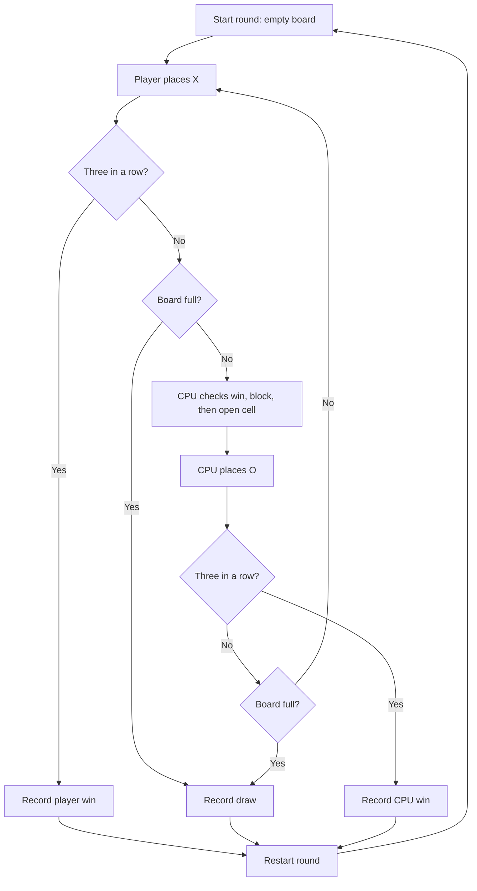

# TriMark

TriMark is a polished, quick-play tic-tac-toe game: amber X versus a cyan O CPU. It is built with Vue 3, TypeScript, and Vite, with no backend or account required.

**Play now:** [oscarmmi.github.io/tic-tac-toe](https://oscarmmi.github.io/tic-tac-toe/)

## How to play

- You are X and go first. Click or tap any empty square to place your mark.
- On a keyboard, use the number pad layout: `7 8 9` on the top row, then `4 5 6`, then `1 2 3`.
- Make three in a row horizontally, vertically, or diagonally to win. A full board without a line is a draw.
- The CPU takes a winning move when available, blocks your immediate win, and otherwise chooses an open square.
- Press `R` or select **Restart** for a new round. Wins, draws, and losses are saved in this browser.

## Run locally

```sh
npm install
npm run dev
```

Run the game-logic tests and production build:

```sh
npm test
npm run build
```

## Game loop



## Built with

- Vue 3 and TypeScript
- Vite
- Vitest for pure game-logic tests
- GitHub Pages for static hosting
